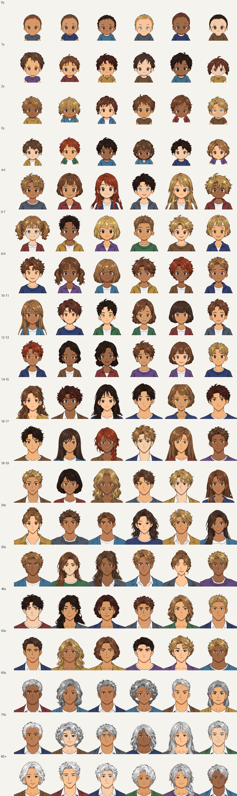

# chara-parts

Draw a whole character once, cut the reusable parts out of it by fixed rules, and recombine the parts at random — across **19 age stages, from newborn to 80+**. This repository holds the rendering and part-extraction code, the part library (310 registered drawings, split into face, eyes, brows, nose, mouth and hair layers plus body/clothes layers), and the test suite.

It is a work in progress. The pictures are good; the ages are **not yet reliably distinguishable** from one stage to the next. Read [How good is it, honestly](#how-good-is-it-honestly) before you build on it.



## Try it

Python 3.11 or newer. A clone downloads about 200 MB and takes about 420 MB on disk with the working tree (the part library is PNG; there is no Git LFS).

```bash
git clone https://github.com/y-nishizaki/chara-parts
cd chara-parts
python3 -m venv .venv && . .venv/bin/activate
pip install -r requirements.txt -r requirements-dev.txt

python3 sample_sheet.py --stages 4-5 30s 80+ --columns 4 --size 256 --seed 3 --out small.png   # about a minute
python3 sample_sheet.py --out sheet.png          # every stage, six characters per row; about 8-9 minutes, about 2 GB of memory
python3 -m pytest -n 2                            # 20-55 minutes depending on the machine, about 2 GB of memory per worker: it renders a lot of faces
```

The memory figures are the peak resident size measured in a 2-core Linux container with 7 GB of memory, where the sample sheet took about 8-9 minutes and the test run about 20-25 minutes. On GitHub-hosted runners (Actions) the test run took about 20-45 minutes on the public runners (macOS, Linux and Windows, 3-4 vCPU) and 54 minutes on the 2-vCPU private-repository runner. CI checks types with `mypy` on Python 3.11, the oldest supported version; on Python 3.12 or newer with numpy 2.5, `mypy` reports three `call-overload` errors (on `.min()` and `.max()`), which comes from numpy 2.5's type stubs together with `python_version = "3.11"` in `pyproject.toml`, so run it on 3.11 as CI does.

Render one character from a spec file:

```bash
python3 - <<'PY'
import json, render_whole as rw
json.dump(rw.random_specs(seed=5, count=1, age_band="60s")[0], open("spec.json", "w"))
PY
python3 render_whole.py spec.json one.png --size 512
```

`random_specs(seed, count, age_band=...)` takes either an age *stage* (see below) or one of the six broader groups (`infant`, `child`, `teen`, `adult`, `mid`, `senior`). Without `age_band` it draws from all of them. The same seed gives the same characters.

## Age stages

`0y 1y 2y 3y 4-5 6-7 8-9 10-11 12-13 14-15 16-17 18-19 20s 30s 40s 50s 60s 70s 80+` — 19 stages, each belonging to one of the six groups. A stage has its own set of source drawings (`ages_registry.json` lists every drawing with its group and stage). The group decides body shape, wrinkle strength, grey hair and clothes; the stage decides which faces can be drawn.

## How it works

1. **Whole drawings.** Each source is a single full character drawn at once (not part by part), plus a bald version of the same drawing. The drawings were generated with an AI image-generation tool (see [About the artwork](#about-the-artwork)).
2. **Extraction (`extract.py`).** Fixed rules cut each drawing into layers at the original coordinates: `base` (head and neck with the face features filled in), `eyes`, `brows`, `nose`, `mouth`, `hair_front`, `hair_back`, `hair_thin`, and `wrinkles` for older stages. Bodies and clothes are cut the same way into `assets/parts_whole/bodies/`. Face landmarks are measured by `auto_marks.py` and corrected by hand in `landmarks.manual.json`.
3. **Rendering (`render_whole.py`).** Takes a spec (which drawing supplies the face, eyes, brows, nose, mouth and hair; skin, hair and eye colour; outfit; age) and composes the layers on a body, with fixed rules for where each feature sits relative to the landmarks.
4. **Random specs.** `random_specs` draws from shuffled decks so that 20 characters do not repeat parts, and refuses combinations the rules know to look wrong. `lint_faces.py` renders a candidate and rejects pictures with a white gap beside the head, a face/hair misalignment or a stray fragment; the generator re-draws those.
5. **Age score (`age_score.py`).** Scores how well the stages can be told apart (see below).

## Layout

| Path | What |
| --- | --- |
| `render_whole.py`, `ages.py`, `mouths.py`, `lint_faces.py`, `sample_sheet.py` | Rendering, age tables, random specs, picture lint, contact sheets |
| `extract.py`, `auto_marks.py`, `onboard.py`, `make_golden.py` | Cutting parts out of whole drawings; adding drawings; regenerating the pinned outputs |
| `age_score.py`, `age_score_latest.json` | Age-legibility scoring and the latest result |
| `ages_registry.json` | The 310 registered drawings (id, group, stage) |
| `assets/parts_whole/` | The part library (CC BY 4.0) |
| `assets/parts_whole/silhouette/` | 1-bit outline of each original drawing (the originals are not shipped) |
| `samples/overview.png` | The sample sheet above (CC BY 4.0). A test redraws it and requires the same pixels |
| `tests/` | The test suite, including `golden_adult.json` (60 pinned renders, compared pixel by pixel) |
| `.github/workflows/` | CI: lint, types, secret scans, tests on Linux/macOS/Windows × Python 3.11–3.13, CodeQL, Scorecard |

## Adding a drawing

The source drawings (about 600 MB at full size) are **not** in this repository, so `extract.py` cannot be re-run from a clone: it expects the complete original set under `whole/raw/`. What you can do:

- **Add a drawing by writing its layers yourself.** Create `assets/parts_whole/<id>/` with the eight 1254×1254 RGBA layers `base`, `brows`, `eyes`, `hair_back`, `hair_front`, `hair_thin`, `mouth`, `nose` (all in the original drawing's coordinates), add the drawing's entries to `landmarks.json` and `meta.json` in the same folder, add a 1-bit outline to `silhouette/<id>.png`, and register it with `python3 onboard.py register <group> <stage> <id>`. Then run the tests.
- **Extend the extraction itself.** `extract.py`, `auto_marks.py` and `onboard.py` are the record of the rules; they work on a `whole/raw/<id>.png` plus `<id>_bald.png` pair for every registered id.

## How good is it, honestly

The numbers below were measured on the code and drawings in this repository (the only later changes are this README, `age_score_latest.json` and trailing whitespace in one code comment). What was not measured is marked as such.

**Tests.** The suite passes with one expected failure on purpose: the age-score acceptance line (0.8) is not reached, so that test is marked `xfail` instead of being lowered. A few tests compare against the original full-size drawings, which are not shipped; they are skipped unless `CHARA_ORIGINALS` points at a folder holding them.

**Picture lint.** Over 380 random characters (20 per stage, seed 1), `lint_faces.py` flags 27 (7.1%): head size off the stage median 15, white gap beside the head 8, face/hair misalignment 5, stray fragments 0 (the four counts add up to 28 because one picture trips two flags). The generator re-draws gaps, misalignments and fragments; head size is relative to the whole stage, so it is not re-drawn. The thresholds separate "fixed" from "broken" pictures well but not perfectly. Newborn-to-3-year faces that are the same face recoloured are *not* caught by this lint.

**Can the stages be told apart? Only roughly.** A blind scorer (Claude Haiku sub-agents shown unlabelled sheets of 10 renders, 10 characters per stage = 190 pictures, two independent runs averaged) estimates the age of each picture. The mean ordering score between neighbouring stages is **0.660**, short of the 0.8 target. The weakest neighbours: 20s→30s 0.360, 60s→70s 0.435, 16-17→18-19 0.465, 4-5→6-7 0.475, 2y→3y 0.515, 10-11→12-13 0.530; the strongest: 3y→4-5 1.000, 50s→60s 0.945, 12-13→14-15 0.905 (each is the average of two runs, so three decimals are kept). The scorer itself: the same picture scored in the two runs differs by a root-mean-square of 4.1 years, i.e. 2.9 years of standard deviation per run (that is, sqrt(mean((a−b)²/2))), and its estimates correlate 0.954 (rank) with the true age (the two runs correlate 0.973 with each other), so it reads **coarse groups reliably (baby < child < young < adult < senior) but not differences inside 4–13, 14–19 or 60+**: the median estimate is 10–11 for every stage from 4-5 to 10-11, and 66–70 for 60s, 70s and 80+. The scorer is fragile: a first attempt in which one instance read all 19 sheets in one go degraded on the later sheets (rank correlation with the true age 0.35–0.39, against 0.95 with 3–4 sheets per instance), and was discarded. How well the scorer agrees with how a human perceives age is **not verified**.

**Critique by reviewers (not passing).** Two independent LLM reviewers (an art-director reviewer and a player reviewer) judged the set against a written 9-point rubric. Both **fail** it.
- Art reviewer: passes 4 of 9 points (face volume, expression, clothes, colour); fails hair (newborn hair looks like a cap, bob cuts like a helmet), distinct faces, "does not look mass-produced", variety within a stage, and "neighbouring age stages differ enough". Scores 4/10 for ages 0–19 and 6/10 for 20+.
- Player reviewer: passes 5 of 9 points (hair, face volume, expression, clothes, colour); fails distinct faces, "does not look mass-produced", variety within a stage, and the neighbouring-stages point. Scores 6/10 for ages 0–19 and 5/10 for 20+.
- Both agree on what is wrong: inside a stage the faces share almost one eye, nose and mouth shape (the 0–3 year rows read as one face recoloured), 4–13 cannot be put back in age order, and the oldest faces look like grey hair on a young face. Both pass line quality, shading, clothes and colour.
- Each reviewer opened 8 images (including a sheet of native-size 64×64 renders) and saw no calibration set of earlier verdicts. Their verdicts move between rounds (an earlier round on a smaller set of images gave 7/9 and 6/9), so read them as "not passing", not as a trend.

So: **do not rely on the stage label as a visible age, and expect repeated faces inside a stage.** Roughly, 1–3, 4–13, 16/18 to 30s, and 60s–80+ are hard to tell apart. Drawing quality (lines, shading, clothes, colour) is the strong part; face variety and age legibility are the weak part and the thing being worked on.

**Not measured:** how a person (rather than an LLM) judges the ages or the pictures; anything beyond the machine the numbers came from (macOS, Python 3.12) — the CI matrix runs the tests on Linux, macOS and Windows with Python 3.11–3.13, but its results are not part of these numbers.

## About the artwork

The pictures under `assets/` were generated with an AI image-generation tool and then cut apart, cleaned and recoloured by the code here. The prompts are not included. Whether AI-generated images can be copyrighted differs by country; the license below applies to whatever rights exist. Image files were re-saved without metadata (no EXIF, no embedded prompt text), and invisible pixels were zeroed, which does not change how they render.

## License

- Code and all data and configuration files — `*.py`, tests (including `tests/golden_adult.json`), `ages_registry.json`, `age_score_latest.json`, the JSON files in `assets/parts_whole/`, `pyproject.toml`, requirements, CI, and this README: MIT — see [`LICENSE`](LICENSE).
- Artwork — the image files (`*.png`) under `assets/`, and the sample sheet `samples/overview.png` (outside `assets/`): Creative Commons Attribution 4.0 International — see [`assets/LICENSE`](assets/LICENSE), which names `samples/overview.png` too. Credit "y-nishizaki" and link back to this repository.
